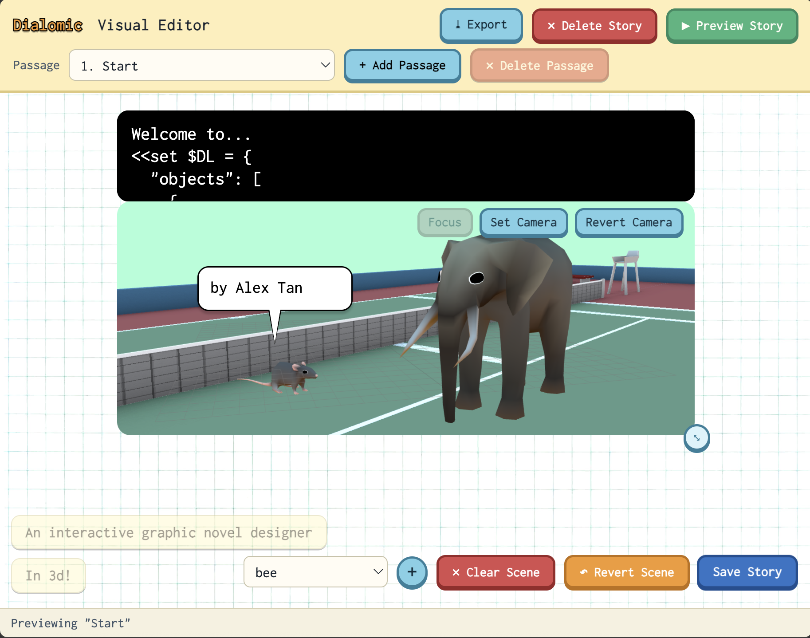
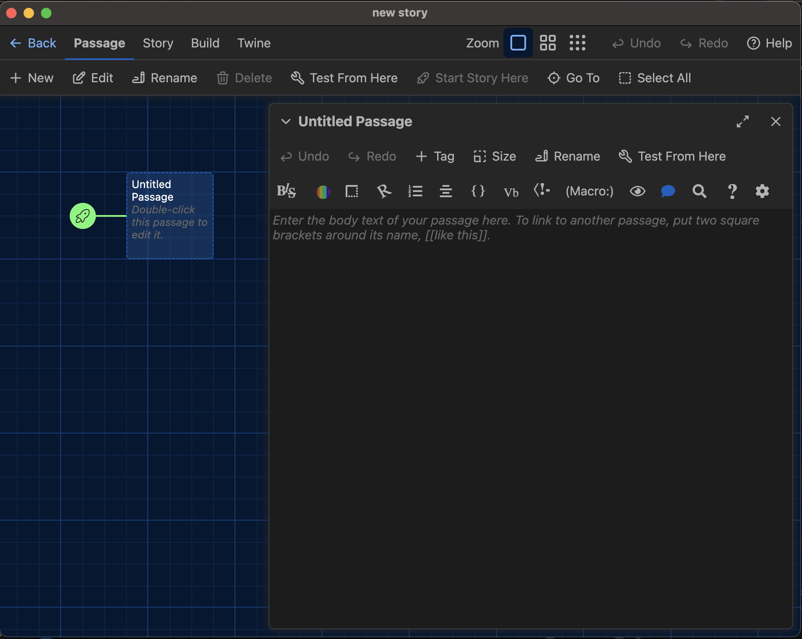
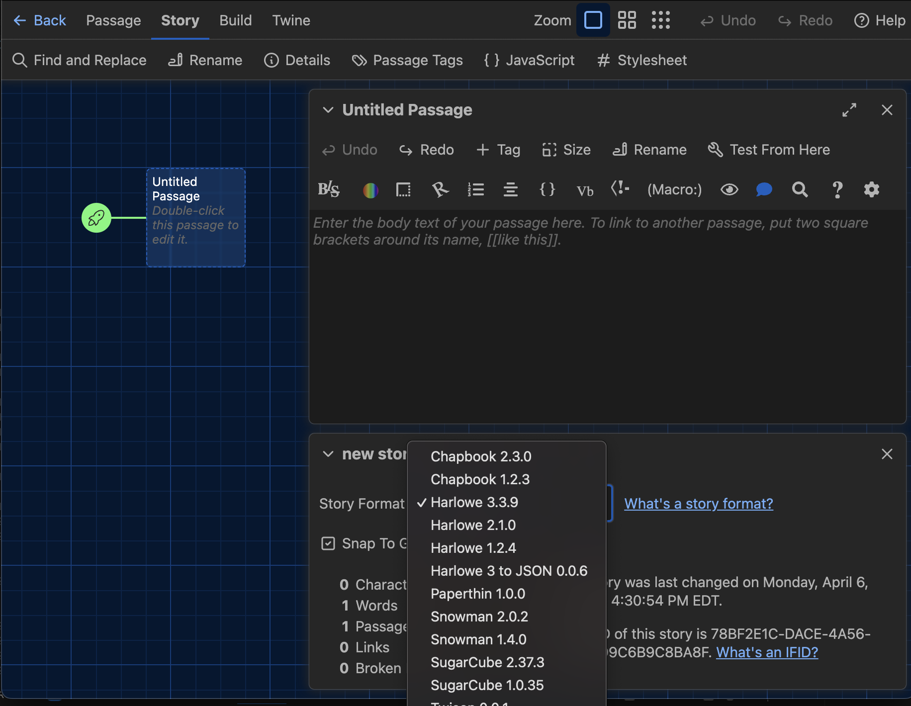
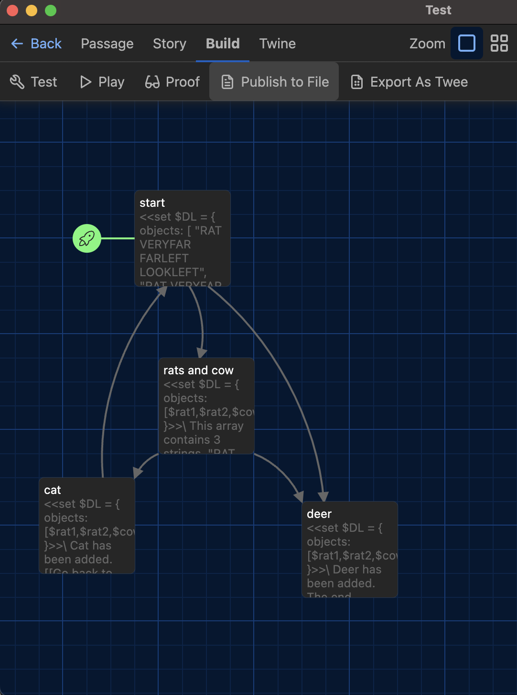
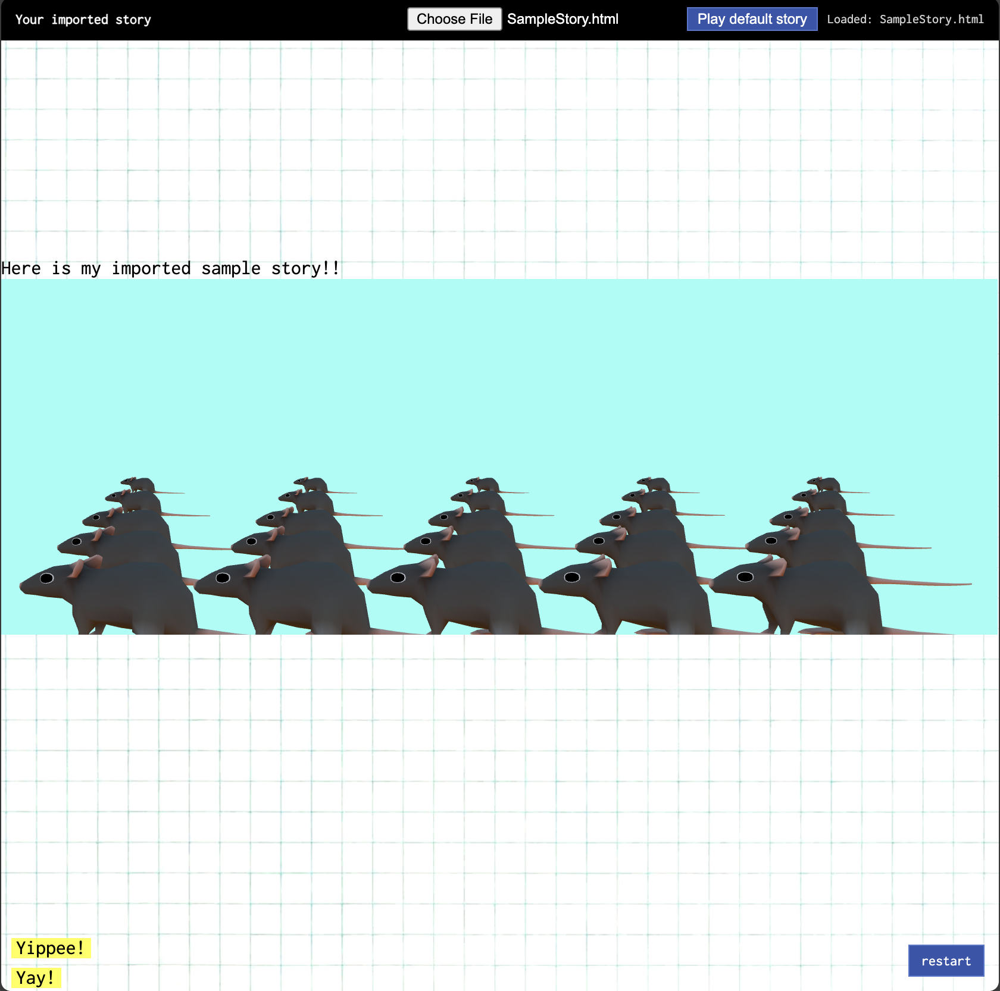
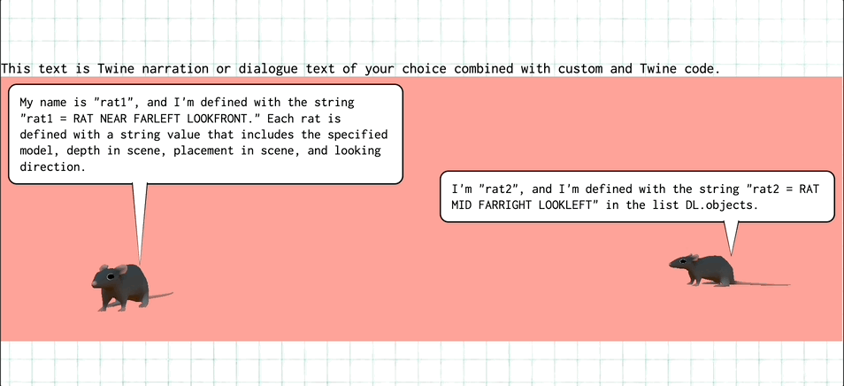
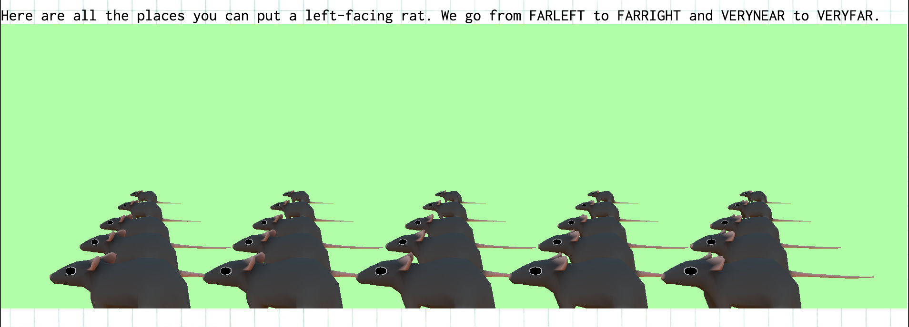

# Dialomic
[Try Dialomic here!](https://alextangnt.github.io/dialomic/)

## Dialomic Visual Editor Creation
Dialomic is an interactive 3D graphic novel designer and runtime for Twine/SugarCube stories.


### Getting Started
1. Visit the [home page](https://alextangnt.github.io/dialomic/)
2. Click `+ New Story` to start from the template, or import an existing HTML story in the Play container.
3. Click `▶ Play` to open the Dialomic Player and run the current story.
4. Click `✎ Edit Story` in the Player to open Dialomic Visual Editor on the active story/passage.
5. In Visual Editor, edit scenes directly: models, transforms, background/sky, speech bubbles, narration, choices, and scene macros.
6. Use `Save Story` to commit scene/text changes and `Preview Story` to return to Player.


### Editing Scenes in the Visual Editor
Here's an example of the typical layout for the visual editor after you've created a story.


#### Passage Selection
Your story is controlled by navigating through various **Passages**, which each contain a **Scene** and any accompanying text through narration and speech bubbles. Passages can contain **Choices**, which are links that lead to any other defined passage.

When creating a new story, you are placed at the **Start** passage by defailt. If you are editing a story from the Player, you are placed at the passage that you last viewed. **Start** is the passage that displays first when you begin the story. In the dropdown in the top left, you may select any currently defined passage and edit the corresponding scene.

There is an unnumbered passage called **StoryInit** that doesn't contain a scene. **StoryInit** is where you write code for any global variables or macros that you want to reference later down the line. Referenced variables will not display correctly if they are visualized in the scene, but they will work when the story itself plays.

#### Camera Buttons
* **Focus:** Focuses camera on selected model so that it's fully in shot
* **Set Camera:** By default, the camera used in the editor does not match the camera that will be seen in the scene when the story is played. Click this button to set that camera to your current view.
* **Revert Camera:** Clicking this button returns the camera to the saved scene position


### Reading and Editing Passage Code 
To view passage code rather than the visualized scene, click into the black box where narration would typically go when you play the story. This window is where you would modify and check information relating to your passage and scene through text or code. At this stage, you must click into the text editor to edit and add choices.

Please view [Sugarcube](https://www.motoslave.net/sugarcube/2/) documentation and format with Sugarcube code if you wish you use macros in your story!

Passage data is split into three tabs:

#### Text
This tab stores all narration, speech bubbles, and so forth.

#### Scene
This tab mostly contains the scene data stored as (`$DL`).
The Visual Editor writes scene state into a SugarCube macro like:

```twine
<<set $DL = {
  objects: [
    {
      "id": "rat1",
      "spec": "RAT MID CENTER LOOKLEFT",
      "position": [0, 0, 0],
      "rotation": [0, 0, 0],
      "scale": [1, 1, 1]
    }
  ],
  "background": { "name": "none" },
  "skyColor": "#bfe3ff"
}>>
```

- `objects` is the model list for that passage.
- `id` is the speaker/object key used by `speakerKey::` lines.
- In Visual Editor, `spec` defaults to just `MODEL` for model name (for example `"rat"`).
- Text-only authoring may use extended shorthand like `MODEL DISTANCE LOCATION FACING`.
- `position`, `rotation`, `scale` are explicit transform overrides.
- `background`, `skyColor`, and optional `camera`/`config` control scene environment and panel behavior.

Important: this Visual Editor format is different from the older text-only object-key patterns.  
If you are authoring text-only, Dialomic still supports multiple declaration styles for `DL.objects` (e.g. keyed object maps, arrays of keyed strings like `rat1= ...`, and array/object variable references). The Visual Editor standardizes edits into a JSON-like `$DL` block so scene transforms are explicit and round-trip safely.

#### Choices
Choices are formatted as `[[Link Text|Linked Passage Name]]`. When this passage is played, Dialmoic will render a choice underneath your scene panel with the text `Link Text`, that takes you to the passage `Linked Passage Name` when clicked.

Currently, you have to make a new passage New Passage button, but this will be updated in later patches.

---

## Dialomic Text-Only Creation (OLD)
Dialomic turns Twine stories into interactive webcomics with animated 3D panels, narration overlays, and speech bubbles. Authors write standard SugarCube passages and add a few formatting conventions so scenes and dialogue can be parsed automatically.

Visit the [Dialomic web player](https://alextangnt.github.io/dialomic/) for a sample story and to play your stories!

### Getting Started
1. Download the [Twine desktop app or use the online editor](https://twinery.org/).
2. Make a new story.

3. Go to `Story>Details>Story Format`, change the format to `SugarCube 2.37.3`.

4. Set up your scene, speech bubbles, and choices! (See below)
5. When finished, export a .html file in `Build>Publish to File`

6. To preview your story, visit the [Dialomic web player](https://alextangnt.github.io/dialomic/) and upload your file at the top! Make edits to your Twine story as needed. Happy comicing!

(This is a different story from the screenshot above)

## Passage Formatting
- Paragraphs are split on blank lines, meaning each individual paragraph will be parsed for "speaker" or "narration".
- Everything after `%%%` is ignored by the scene/narration parser (use this to separate narrative from choices if desired).

Example passage block:
```twine
<<set $DL = {
  objects: [
    "rat1= RAT VERYNEAR FARLEFT LOOKFRONT",
    "rat2= RAT MID FARRIGHT LOOKFRONT",
    "RAT NEAR CENTER LOOKLEFT"
  ],
  background: "bus stop"
}>>

rat1:: This is a speaker line that will become a speech bubble.

This is narration (plain passage text).
%%%
[[Choice A|Some Passage]]
[[Choice B|Other Passage]]
```

## Speaker Syntax (Speech Bubbles)
- To mark a paragraph as spoken dialogue, start the paragraph with `speakerKey::`.
- The `speakerKey` must match a scene object key (see Object Keys below).
- Multiple speaker paragraphs are supported. Each speaker paragraph becomes its own bubble.
- Narration is all non‑speaker paragraphs.

Example:
```twine
rat1:: Hello.
rat2:: Hi.

This is narration.
```

## Scene Variables (3D Models)
Your scene should be stored in `State.variables.DL` (i.e., `$DL` in Twine).

Minimum shape:
```twine
<<set $DL = { objects: ["RAT NEAR CENTER LOOKLEFT"] }>>
```

Supported `objects` formats:
- Array of strings.
- Object map keyed by object id.

#### Object Keys (For Speaker Matching)
If you want `speakerKey::` to target a model, the key must exist in `DL.objects`.

Option A (recommended): object map keyed by id
```twine
<<set $DL.objects = {
  rat1: "RAT VERYNEAR FARLEFT LOOKFRONT",
  rat2: "RAT MID FARRIGHT LOOKLEFT"
}>>
```

Option B: array with `key=SPEC` strings
```twine
<<set $DL.objects = [
  "rat1= RAT VERYNEAR FARLEFT LOOKFRONT",
  "rat2= RAT MID FARRIGHT LOOKLEFT"
]>>
```

With this text underneath:
```
rat1:: My name is "rat1", and I'm defined with the string "rat1 = RAT NEAR FARLEFT LOOKFRONT." Each rat is defined with a string value that includes the specified model, depth in scene, placement in scene, and looking direction.
rat2:: I'm "rat2", and I'm defined with the string "rat2 = RAT MID FARRIGHT LOOKLEFT" in the list DL.objects.

This text is Twine narration or dialogue text of your choice combined with custom and Twine code.
```

Both of the above formats produce this result.




#### Object Spec String Format
Each object string follows:
```
MODEL DISTANCE LOCATION FACING
```

Accepted tokens:
- Distance: `VERYNEAR`, `NEAR`, `MID`, `FAR`, `VERYFAR`
- Location: `FARLEFT`, `LEFT`, `CENTER`, `RIGHT`, `FARRIGHT`
- Facing: `LOOKLEFT`, `LOOKFRONT`, `LOOKRIGHT`, `LOOKBACK`



#### Accepted Model Tokens (Animals)
Use the model name as the first token. These map to `.glb` files in `public/assets/animals/`. As of now, authors have access to:
- `RAT`
- `CAT`
- `COW`
- `DEER`
- `ELEPHANT`
- `HARE`
- `WOLF`

If you add new models to `public/assets/animals/`, just use the filename (case insensitive) as the token.

#### Background Models
Set a background with:
```twine
<<set $DL.background = "bus stop">>
```
This loads:
```
public/assets/backgrounds/bus_stop.glb
```
Accepted background tokens (from `src/backgrounds.js`):
- `BUS STOP` (slug: `bus_stop`)
- `BEACH`
- `TENNIS COURT` (slug: `tennis_court`)
- `BALLPARK`

Slug rules:
- Lowercase
- Spaces and punctuation become `_`

Defaults are applied for position/scale unless you extend the code.
Per-background transforms can be defined in `src/backgrounds.js`.

#### Shot Control
Set a shot with:
```twine
<<set $DL.shot = "MEDIUM rat1">>
```

Accepted shot tokens:
- `LONG`
- `FULL`
- `MEDIUMLONG`
- `MEDIUM`
- `MEDIUMCLOSE`
- `CLOSE`

Usage rules:
- Format: `SHOT_TOKEN target1 [target2 ...]`
- `LONG` and `FULL` can use multiple targets.
- `MEDIUMLONG`, `MEDIUM`, `MEDIUMCLOSE`, and `CLOSE` use one target (if multiple are provided, only the first is used).
- Shot framing is applied after scene models finish loading.
- `MEDIUM`, `MEDIUMCLOSE`, and `CLOSE` adapt framing to the target model's size.

Examples:
```twine
<<set $DL.shot = "LONG rat1 rat2">>
<<set $DL.shot = "CLOSE rat1">>
<<set $DL.shot = "MEDIUMCLOSE rat2">>
```

#### Panel Layout Config
You can control automatic panel stacking with `DL.config`:

```twine
<<set $DL.config = {
  panels: "stack",
  rows: 3,
  cols: 1,
  aspect: "free"
}>>
```

Rules:
- `panels` defaults to `"stack"` (`"cycle"` is reserved/not fully implemented).
- `rows` and `cols` default to `1` when omitted.
- `rows` and `cols` are clamped to `1..3`.
- `aspect` supports `"free"` (default) or `"fixed"`.
- Capacity is `rows * cols`; once full in stack mode, current panels animate out and stacking restarts.
- If a panel already on screen is shown again, it is reordered rather than duplicated.

Aspect behavior:
- `"free"`: panel containers stretch to fill each grid slot.
- `"fixed"`: panel containers keep a consistent aspect ratio across the grid layout and scale within the available slot.

Per-passage command tokens (inside passage text):
- `%%solo%%`: show current panel alone, and next panel starts without the current panel.
- `%%resets%%`: clear current stack before showing the new panel.
- `%%rows=N%%`, `%%cols=N%%`, `%%panels=stack|cycle%%`, `%%aspect=fixed|free%%`: override layout config for that passage.

#### Twine Variables and Custom State
You can define reusable object specs as variables and reference them in `DL.objects`.

Example:
```twine
<<set $rat1 = "RAT VERYNEAR FARLEFT LOOKFRONT">>
<<set $rat2 = "RAT MID FARRIGHT LOOKFRONT">>
<<set $DL.objects = [$rat1, $rat2]>>
```

#### Narration vs Speech Bubble Rendering
- Speaker paragraphs (matched with `speakerKey::`) render as speech bubbles.
- All other paragraphs render as narration above the panel.
- Multiple speaker paragraphs produce multiple bubbles.

## Choices / Links
- Any SugarCube `[[link]]` becomes a choice button in the UI.
- The UI uses the link’s HTML as the label (so you can include formatting in the link text).
- Choices are rendered at the bottom of the screen

Example:
```twine
[[Show a deer.|Now add a deer.]]
```

## Common Pitfalls
- If a background fails to load, check the filename and slugging (`"bus stop"` -> `bus_stop.glb`).
- If a speaker bubble doesn’t appear, the `speakerKey` likely doesn’t match a scene object key.
- Anything after `%%%` is ignored for narration parsing.

## How It Works (Behind The Scenes)
- The runtime listens to SugarCube’s `:passageend` event (see `public/messaging.js`).
- `public/messaging.js` captures passage HTML and `.link-internal` anchors, then posts them to the app.
- `src/layout.js` parses passage HTML and SugarCube variables (`State.variables`).
- `src/panel.js` builds the 3D scene, speech bubbles, and narration UI.

#### Core SugarCube Concepts
- SugarCube stores story state in `State.variables` (exposed as `$var` in Twine).
- Use `<<set $var = ...>>` to define scene variables.
- Use `[[link text|Passage Name]]` to create choices (SugarCube creates `.link-internal` anchors).

References:
- Twine: https://twinery.org/
- SugarCube documentation: https://www.motoslave.net/sugarcube/2/
- SugarCube macro reference: https://www.motoslave.net/sugarcube/2/docs/
- [Model Attribution](docs/ModelAttribution.md)
