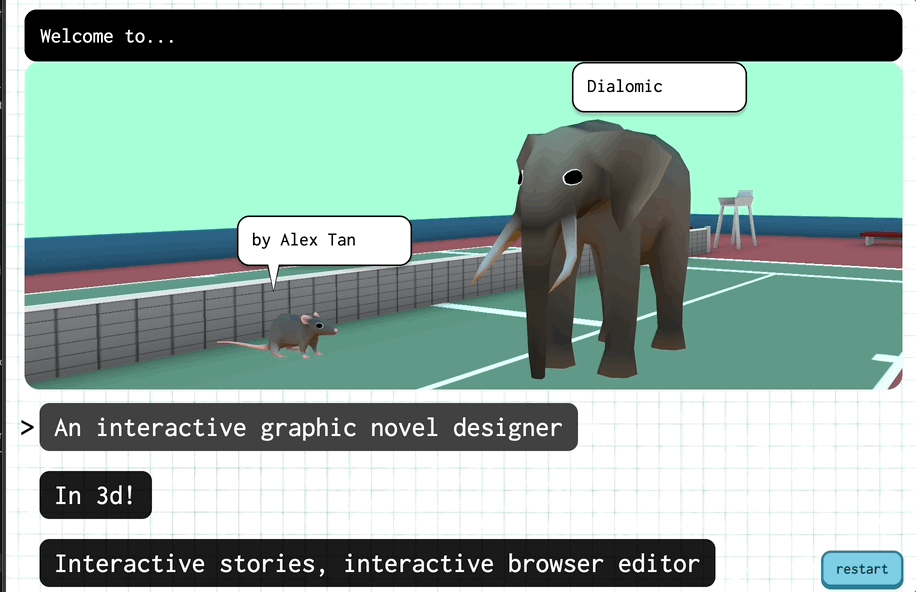
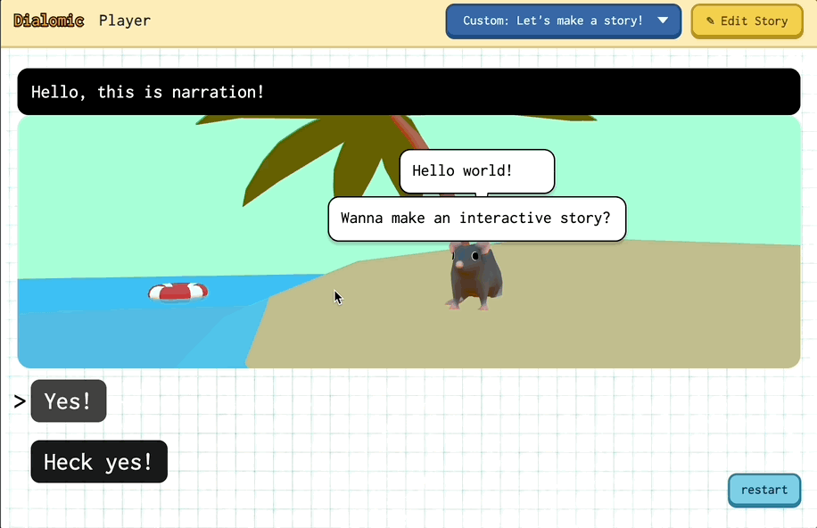
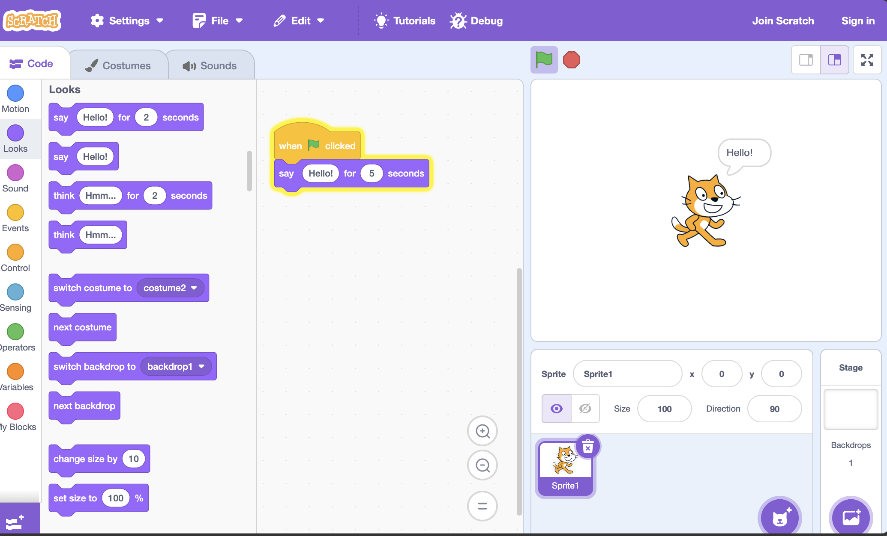
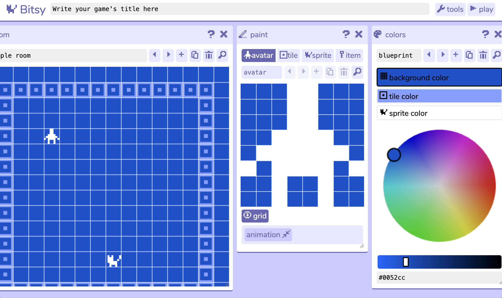
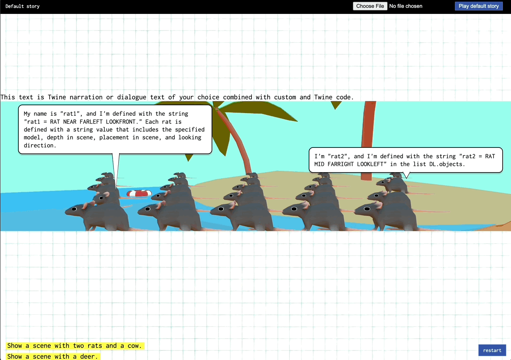
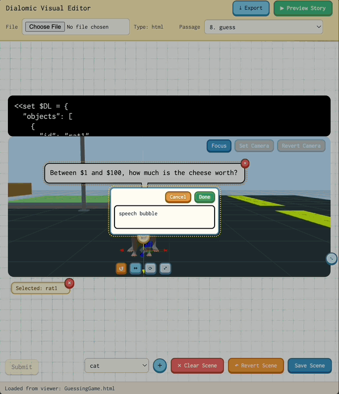
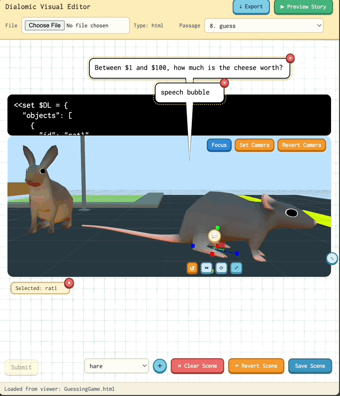
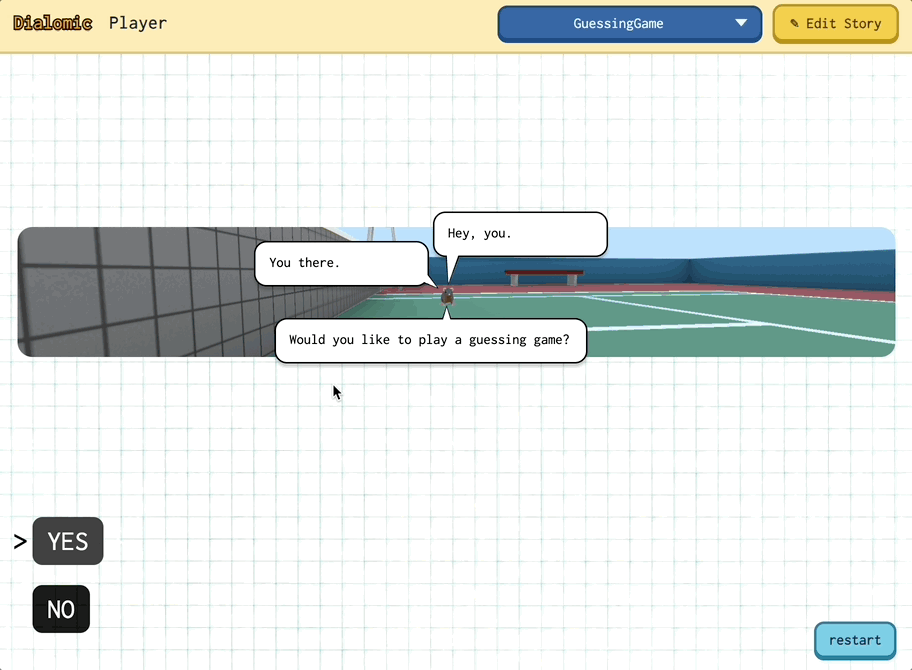
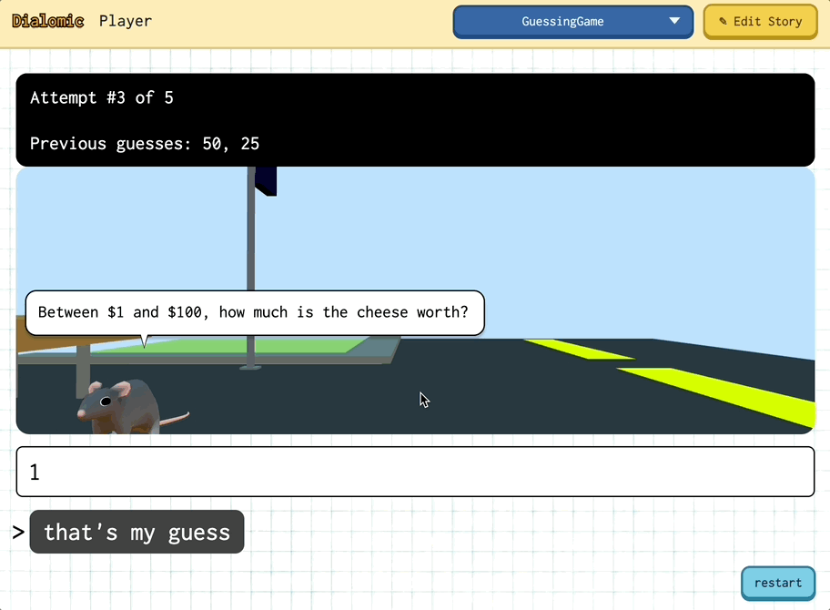

## 1. Project Overview
Dialomic is a browser-based application for creating and playing interactive 3D webcomics using Twine/SugarCube story logic. It combines:
- A **Player** that runs a story.
- A **Visual Editor** that lets authors create stories from scratch and edit stories. The author can edit scene composition, dialogue bubbles, narration, and passage content directly.

The core goal is to keep Twine's narrative and scripting strengths while giving authors a visual scene workflow that does not require rebuilding a custom game engine.


## 2. Problem and Motivation
Traditional visual-novel or game pipelines require heavy art and tooling overhead (scene layout, branching UI logic, state management, export/deploy). Twine solves branching narrative and scripting elegantly, but is primarily text-based and requires heavy overhead for visuals.

This project began because I wanted to make a storytelling tool for artists. I like comics, I like interactive media, I like games and funky little clickable tools, but I’m not very good at making games. I like picking through the capabilities of tools people give me and see how funnily I can make them spin. By making a tool *I* can use, that my friends and I can use, I’m shortcutting the “What do I use to tell my story” step that I always deliberate on. I made Dialomic because I wanted to preserve Twine's simplicity while adding panelized 3D staging and comic-style presentation.

This project is heavily inspired by browser-based creation tools, especially those for coding and game prototyping like [Scratch](https://scratch.mit.edu/) and [Bitsy](https://scratch.mit.edu/).




[Twine](https://twinery.org/) itself is a huge inspiration as well, obviously. There are also engines like [Ren'Py](https://www.renpy.org/) for visual novels, but they aren't quite as intuitive as Twine, and there's still a ton of overhead if you plan to make custom visuals.

Despite the fact that one can tell interactive stories Scratch, Bitsy, or base Twine, I haven't seen one that easily combines Twine's logic and story control engine with 3D visuals, especially on the browser. Crafting 3D scenes directly in the browser with [three.js](https://threejs.org/) allows for a ton of flexibility and iteration in shot and scene composition, as well as procedural animation.

## 3. System Evolution: Text-Only to Visual Editor
### Initial Text-Based Phase
I started this process with a fully text-based workflow. I didn't know how powerful three.js was, and thought that making a visual editor would be way too difficult. I also didn't know much about how Twine built .html files using story formats.

Essentially, I presumed the author would create a Twine story however they felt most comfortable. Through the Twine app, in the browser, or as a .twee file that was built and turned into html. I expected authors to compose each scene fully in text within their passages. See the [text-based documentation](textOnly.md) for more details. Essentially,
- Authors wrote SugarCube passages.
- Scene state lived in passage variables (primarily `$DL`).
- Objects were defined in the scene states as strings. If an object was given a tag, it became a speaker. These strings included model type, as well as the object's position and orientation in the scene. I defined a whole language of string tokens to define an object's "stage placement" in the scene.
- Dialogue bubbles used `speaker:: line` syntax.
- A messaging bridge connected a hidden Twine runtime iframe to Dialomic's rendering layer.
- Paragraphs are split on blank lines, meaning each individual paragraph will be parsed for "speaker" or "narration".
- Everything after `%%%` is ignored by the scene/narration parser, so choice text doesn't get included in narration.

Example passage block:
```twine
<<set $DL = {
  objects: [
    "rat1= RAT VERYNEAR FARLEFT LOOKFRONT",
    "rat2= RAT MID FARRIGHT LOOKFRONT",
    "RAT NEAR CENTER LOOKLEFT"
  ],
  background: "bus stop"
}>>

rat1:: This is a speaker line that will become a speech bubble.

This is narration (plain passage text).
%%%
[[Choice A|Some Passage]]
[[Choice B|Other Passage]]
```


In this model, Twine drives logic and stores variables, Dialomic renders panels based on those variables.

### Transition to Visual Editing
As scene complexity grew (camera, model transforms, backgrounds, bubble placement, multi-panel layout), raw text editing became error-prone and harder to maintain. Also, I wanted to create my own stories the system I had created, but the positioning system would have been too limiting for the shots I wanted to compose in a more serious story.

As it stands, Dialomic's strengths are in it's lego-like, low-poly simplistic models that work as default sprites. However, I wanted to be able to use my own models and position them more freely in the future. As such, I developed a visual editor attached to the web player to manually edit 3d scenes directly in the browser.




The Visual Editor was introduced to:
- Select passages and edit scene state directly in 3D.
- Edit narration/speech/choices with immediate preview context.
- Keep passage text and scene preview synchronized.
- Support save/revert flows and safer mutation paths for story content.

In the end, I have a hybrid workflow where authors can still inspect and edit the text-based data structures, but the mundanity of scene composition happens in the editor. It works like most 3d editors in Blender, Maya, Unity, etc. Core features include:
- Model and background gizmos to position, scale, and rotate
- Buttons to add and delete models
- UI to add, edit, and delete speech bubbles
- Natural camera positioning


### Scene Contract (`$DL`)
In the current stage, the data structure for a scene is still called $DL. This is essentially a .json that stores all the necessary information to recreate the scene.

Common keys include:
- `objects`
- `background`
- `skyColor`
- `camera`
- `config` (panel stacking/grid/aspect behavior)

Since the scene is still stored as text, and is live updated through both text editor changes and 3d scene updates, scenes can be copied from passage to passage!

## 4. The Future of Dialomic
Here's a sample game by Katherine Wang, (slightly edited for display)

This example shows multiple panels stacking for some pages, and solo panels for other pages. Panel layout control is one of the things I definitely want authors to be able to play with.

I recently added the ability to scroll through the history of the story while playing. Currently, it's a bit hard to see what's happening, but each previous page of panels using those historical states re-displays in order.

There is no limit to the features I want to add, even at this current stage and release. Some of these features may require a major rework of my general editor layout, which can definitely be a bit of a pain.
- Manual bubble layout!
- Custom fonts and speech bubble customization
- Interactive choice editor and creation
- Renaming stories, renaming passages
- Importing custom models
- More default animations, as well as the ability to add custom animation clips. Rigged models!?